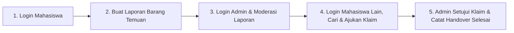

# Skenario Perekaman Video Demo MVP CampusFind (`demo.mp4`)

- **Estimasi Durasi:** 3 – 5 Menit
- **Target Resolusi:** 1080p (Full Screen Recording)
- **Alur Utama:** Mahasiswa Melapor -> Admin Memverifikasi -> Mahasiswa Lain Mencari & Mengklaim -> Admin Menyetujui Klaim & Menyelesaikan Handover.

---

## Ringkasan Alur Demo End-to-End



---

## Naskah & Panduan Aksi Langkah Demi Langkah (Step-by-Step)

### Scene 1: Pembukaan & Overview Proyek (00:00 - 00:30)
* **Aksi di Layar:**
  - Buka browser di halaman utama (`http://localhost:5173`).
  - Scroll perlahan melihat statistik singkat dan katalog barang publik.
* **Narasi Suara:**
  > *"Halo semuanya. Pada video kali ini saya akan mendemonstrasikan hasil akhir aplikasi MVP CampusFind—Sistem Informasi Kehilangan dan Temuan Barang Kampus. Aplikasi ini mencakup 5 fitur inti: Autentikasi Pengguna, Pelaporan Barang, Pencarian & Filter, Proses Klaim & Handover, serta Moderasi Admin."*

---

### Scene 2: Fitur 1 (Auth) & Fitur 2 (Pelaporan Barang) (00:30 - 01:20)
* **Aksi di Layar:**
  1. Klik tombol **Masuk** di pojok kanan atas.
  2. Input akun Mahasiswa:
     - **Email:** `student2@campusfind.ac.id`
     - **Password:** `password123`
  3. Setelah masuk, arahkan ke halaman **Laporkan Barang** (`/reports/create`).
  4. Isi form laporan barang temuan (*Found*):
     - **Tipe Laporan:** Ditemukan (Found)
     - **Judul:** `Tumbler Minum Corkcicle Putih`
     - **Kategori:** Aksesori
     - **Lokasi:** `Perpustakaan Lt. 2 Meja 14`
     - **Tanggal/Waktu:** Hari ini
     - **Deskripsi:** `Ditemukan botol minum stainless warna putih polos tertinggal di bawah kursi.`
  5. Klik tombol **Kirim Laporan** (perlihatkan tombol berubah ke loading state lalu muncul notifikasi sukses).
  6. Masuk ke **Dashboard Mahasiswa** (`/dashboard`), perlihatkan status laporan baru otomatis berstatus **PENDING**.
* **Narasi Suara:**
  > *"Pertama, mahasiswa login ke dalam sistem. Mahasiswa membuat laporan barang yang baru saja ditemukan. Saat form disubmit, sistem memvalidasi kelengkapan data mandatory dan otomatis memberikan status awal PENDING untuk menunggu moderasi pihak kampus."*

---

### Scene 3: Fitur 5 (Moderasi & Validasi Admin) (01:20 - 02:05)
* **Aksi di Layar:**
  1. Klik profil -> **Keluar (Logout)**.
  2. Klik **Masuk** dan login sebagai Admin:
     - **Email:** `admin@campusfind.ac.id`
     - **Password:** `password123`
  3. Sistem otomatis mengarahkan ke **Admin Dashboard** (`/admin`).
  4. Perlihatkan kartu statistik dan tabel antrean **Laporan Menunggu Verifikasi**.
  5. Temukan laporan `Tumbler Minum Corkcicle Putih` yang baru dibuat.
  6. Klik tombol **Verifikasi / Setujui (OPEN)**. Isi catatan moderator jika ada (*"Barang fisik telah diamankan di pos satpam"*).
  7. Perlihatkan status laporan berubah menjadi **OPEN**.
* **Narasi Suara:**
  > *"Kedua, akun admin memiliki hak akses ke panel moderasi. Admin memeriksa laporan barang temuan yang masuk, lalu memvalidasi statusnya menjadi OPEN agar dapat dilihat oleh publik di katalog pencarian."*

---

### Scene 4: Fitur 3 (Pencarian & Filter) & Fitur 4 (Pengajuan Klaim) (02:05 - 03:00)
* **Aksi di Layar:**
  1. Logout dari akun Admin.
  2. Login sebagai Mahasiswa pemilik barang yang hilang:
     - **Email:** `student1@campusfind.ac.id`
     - **Password:** `password123`
  3. Buka halaman **Jelajah Laporan / Katalog** (`/reports`).
  4. **Uji Fitur Pencarian & Filter:**
     - Ketik keyword `Corkcicle` di search bar -> daftar langsung tersaring.
     - Pilih filter kategori `Aksesori` atau status `OPEN`.
     - Coba ketik keyword acak (misal `xyz123`) untuk memperlihatkan tampilan **Empty State** (*"Belum ada laporan ditemukan"*), lalu hapus kembali.
  5. Klik kartu barang `Tumbler Minum Corkcicle Putih` untuk masuk ke halaman detail (`/reports/:id`).
  6. Klik tombol **Ajukan Klaim**.
  7. Isi form klaim kepemilikan:
     - **Jawaban Bukti:** `Terdapat stiker inisial 'B' di bagian bawah botol.`
     - **Deskripsi Kepemilikan:** `Botol hadiah ulang tahun yang hilang saat belajar kelompok.`
     - **Nomor WhatsApp:** `081234567890`
  8. Klik **Kirim Klaim**. Muncul notifikasi berhasil.
* **Narasi Suara:**
  > *"Ketiga, mahasiswa lain yang kehilangan barang mencari di katalog publik menggunakan fitur pencarian keyword dan filter kategori. Setelah menemukan barangnya, mahasiswa membuka detail laporan dan mengajukan klaim kepemilikan dengan menyertakan bukti spesifik."*

---

### Scene 5: Fitur 4 Lanjutan (Penyelesaian Klaim & Handover Fisik) (03:00 - 03:50)
* **Aksi di Layar:**
  1. Logout, lalu kembali login sebagai Admin (`admin@campusfind.ac.id`).
  2. Buka menu **Daftar Klaim Masuk** di panel admin.
  3. Buka klaim dari `Budi Santoso` untuk tumbler tersebut.
  4. Klik **Setujui Klaim (APPROVE)** -> Status laporan otomatis beralih menjadi **CLAIMED**.
  5. Masuk ke bagian **Catat Serah Terima (Handover)**:
     - Pilih laporan dan klaim terkait.
     - Isi Nama Penerima: `Budi Santoso`.
     - Lokasi Handover: `Ruang Satpam Gedung Utama`.
     - Catatan: `Penerima menunjukkan KTM dan stiker bawah botol cocok.`
  6. Klik **Simpan Handover**.
  7. Tunjukkan bahwa status laporan kini telah resmi menjadi **RETURNED / SELESAI**.
* **Narasi Suara:**
  > *"Terakhir, admin memeriksa bukti klaim yang diajukan. Setelah bukti dinyatakan valid, admin menyetujui klaim sehingga status barang berubah menjadi CLAIMED. Saat mahasiswa datang mengambil barang fisik, admin mencatat serah terima (handover) sehingga status akhir barang resmi menjadi RETURNED."*

---

### Scene 6: Penutup & Pembuktian Unit Test Terminal (03:50 - 04:15)
* **Aksi di Layar:**
  1. Buka layar terminal (VS Code / Command Prompt).
  2. Jalankan perintah:
     ```bash
     npm test --workspace=@campusfind/api
     ```
  3. Tampilkan hasil terminal berwarna hijau: **5 Test Suites Passed, 27 Passed**.
* **Narasi Suara:**
  > *"Seluruh aturan bisnis di backend juga telah divalidasi menggunakan 5 file unit test Jest dengan status 100% Passed. Sekian demonstrasi MVP CampusFind, terima kasih."*

---

## Tips Perekaman:
- Gunakan aplikasi perekam seperti **OBS Studio**, **Xbox Game Bar (Win + G)**, atau **Loom**.
- Pastikan tab browser sudah dizoom 100% atau 110% agar teks terlihat tajam.
- Sediakan terminal di sebelah browser atau di akhir video untuk menunjukkan status test.
